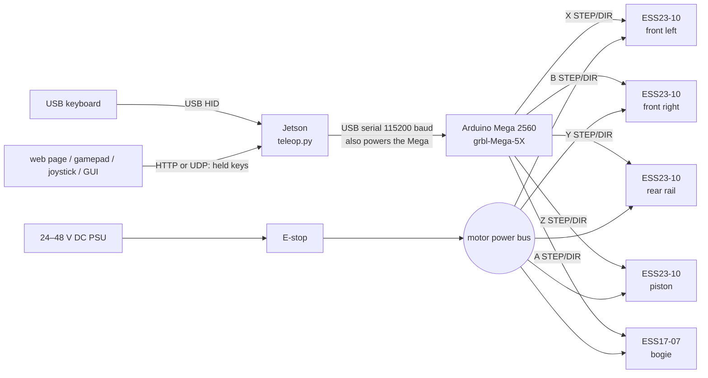
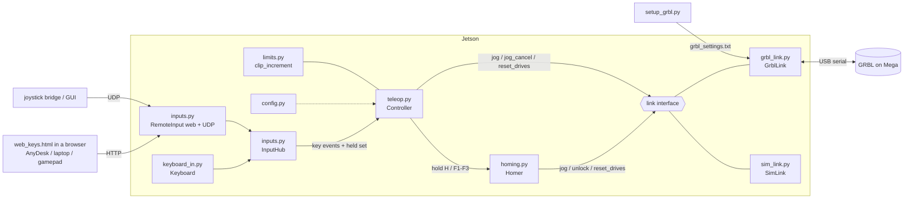

# arm-teleop

Teleoperation for the five linear motors of the arm: front-left and front-right rails (which carry the crossbar), rear rail, piston, crossbar bogie. Each motor has its own GRBL axis.

A Jetson takes held keys, from a keyboard plugged into it or from a remote window / joystick / GUI over UDP, and turns them into short, limit-checked jog commands. It streams them over USB to an Arduino Mega 2560 running **grbl-Mega-5X**, which generates the acceleration profiles and STEP/DIR pulses for five closed-loop stepper drives.

The stack runs on its own. It has no inverse kinematics and no path planner: each key moves one axis, or a fixed combination of axes, at a chosen speed.

If a drive stalls or faults, its alarm output stops all motion through GRBL's abort input. The Jetson then resets the drives by itself, with no power cycle needed if MF clears the fault (see [Drive alarms and reset](#drive-alarms-and-reset)).

There are no home switches. Holding H homes the arm on its hard stops instead: every motor, including each front rail on its own, is driven into its top and bottom stops until its drive stalls. That sets each motor's zero, squares the crossbar, and measures how far each one can go (see [Homing](#homing)).

The terminal shows a full-screen display: positions, faults, the whole key menu and the recent log. Every run also writes a log file in `logs/`.

```
USB keyboard ─────┐
web page / pad ───┼─► Jetson: teleop.py ══ USB serial ══► Mega 2560: grbl-Mega-5X ── STEP/DIR 5 V ──► ESS drives ──► motors
joystick / GUI ───┘   keys → motion → limits → jog lines   accel planning + step pulses                closed loop
 (HTTP / UDP)
```

**Contents:**
[Quick start](#quick-start) ·
[Electrical architecture](#electrical-architecture) ·
[Software architecture](#software-architecture) ·
[Operating](#operating) ·
[Setup](#setup) ·
[Bring-up checklist](#bring-up-checklist) ·
[Known limitations](#known-limitations)

---

## Quick start

```bash
git clone https://github.com/Amitaansh/arm-teleop.git
cd arm-teleop
pip3 install -r requirements.txt

python3 teleop.py --sim      # no hardware: simulated motion, same keys and limits
python3 teleop.py            # real hardware (GRBL on /dev/ttyACM0)

# then open http://localhost:8080 in a browser on the Jetson (e.g. through AnyDesk) and type into it
```

You need Linux with access to the serial port, and to `/dev/input` for a keyboard plugged into the Jetson (see [Setup](#setup)). Without a keyboard on the Jetson, use the web page (see [Remote control](#remote-control-anydesk-laptop-joystick-gui)). On a new rig, follow the [bring-up checklist](#bring-up-checklist) before running against real motors.

---

## Electrical architecture

### System block diagram



Each drive also gets MF (motor free) from its axis's enable pin, and sends ALM (alarm) back. All five ALM lines are joined onto A9. See [Wiring](#wiring-per-drive).

There are two power domains, and their grounds are **not** joined:

| Domain | Source | Feeds | Ground |
|---|---|---|---|
| Logic | Jetson USB port (5 V) | Mega 2560, signal side of each drive's STEP/DIR/MF inputs and ALM output | Mega GND → PU− / DR− / MF− / ALM− on each drive |
| Motor power | 24–48 V DC supply, through the E-stop | VDC+ / GND on each drive | PSU return only |

The drives' STEP/DIR/MF inputs and ALM output are optically isolated, so the Mega only has to drive the input LEDs. Keep the PSU ground off Mega GND. That keeps motor return currents out of the USB and logic ground.

### Axes, drives and mechanics

| GRBL axis | Mechanism | Drive(s) | Transmission | Steps/mm (`$10x`) | Max rate (`$11x`) | Accel (`$12x`) | Travel from zero |
|---|---|---|---|---|---|---|---|
| X | Front-left rail | ESS23-10 | Lead screw, 2 mm lead | 500 | 1200 mm/min (20 mm/s) | 100 mm/s² | 0 to 550 mm |
| B | Front-right rail | ESS23-10 | Lead screw, 2 mm lead | 500 (`$104`) | 1200 mm/min (`$114`) | 100 mm/s² (`$124`) | 0 to 550 mm |
| Y | Rear rail | ESS23-10 | Lead screw, 2 mm lead | 500 | 1200 mm/min (20 mm/s) | 100 mm/s² | 0 to 550 mm |
| Z | Main piston | ESS23-10 | TBD | 100 *(placeholder)* | 2400 mm/min (40 mm/s) | 200 mm/s² | 0 to 500 mm *(placeholder)* |
| A | Crossbar bogie | ESS17-07 | 3:1 onto 15T AT5 belt pulley, 25 mm per motor rev | 40 | 6000 mm/min (100 mm/s) | 500 mm/s² | −224 to +224 mm |

All drives are set to 1000 pulses/rev, so steps/mm = 1000 ÷ (mm of travel per motor rev). The speeds start low on purpose. The rail screws can reach about 36 mm/s before whip, and the bogie belt about 250 mm/s. Raise the limits after bring-up.

### Wiring (per drive)

| ESS wire | Connects to |
|---|---|
| PU+ (red) | Mega STEP pin for that axis |
| DR+ (blue) | Mega DIR pin for that axis |
| PU− (yellow), DR− (black) | Mega GND |
| MF+ (brown) | Mega ENABLE pin for that axis |
| MF− (green) | Mega GND |
| ALM+ (white) | Joined with the other four ALM+ wires, then to A9 (GRBL reset/abort input) |
| ALM− (gray) | Mega GND |
| VDC+ / GND | 24–48 V supply after the E-stop. **Do not join this to Mega GND** |

Plus one part: a **4.7 kΩ pull-up from A9 to 5 V**.

**Front pair.** The two front rails carry the crossbar between them, so they normally move together, but each has its own GRBL axis: front-left on X, front-right on B (the RAMPS E1 pins: STEP D36, DIR D34, ENABLE D30). That lets homing bring each one onto its own stop, which squares the crossbar, and lets you trim one alone (R/F, T/G). The software keeps them together everywhere else (see [Software limits](#software-limits)). Moving from the old shared wiring: take the front-right drive's PU+, DR+ and MF+ off the X pins and put them on D36, D34 and D30. Its PU−, DR−, MF−, ALM+ and ALM− stay where they are. If one front motor runs backwards, flip it with that drive's DIP SW1.

**MF (motor free).** Current through MF frees the motor. GRBL holds its enable pins LOW while running (`$4=0`), so the motors stay energised, and drives them HIGH only when it disables the steppers: on an alarm and in sleep (`$SLP`). `$1=255` keeps the motors energised while idle; any other value would free them every time motion stops.

**ALM (alarm).** Each ALM output is a transistor switch. They are wired in parallel, so any one faulted drive pulls A9 low. The code assumes the output switches **on** during a fault (`ALM_CONDUCTS_ON_FAULT = True` in `config.py`); check this during bring-up. A9 is GRBL's reset/abort input, so a fault stops all step pulses at once, in firmware, without waiting for the Jetson. Which drive faulted is not known: look for the blinking red LED.

**DIP switches (every drive).** SW2, SW3 and SW4 ON with SW5 OFF gives 1000 pulses/rev. This must match `$100`–`$103`. SW1 sets direction.

### Mega 2560 pin map

These pins come from grbl-Mega-5X's default RAMPS map. **Check `cpu_map.h` in your download before wiring.**

| Axis | STEP | DIR | ENABLE (→ MF+) |
|---|---|---|---|
| X (front left) | A0 (D54) | A1 (D55) | D38 |
| Y (rear) | A6 (D60) | A7 (D61) | A2 (D56) |
| Z (piston) | D46 | D48 | A8 (D62) |
| A (bogie) | D26 | D28 | D24 |
| B (front right) | D36 | D34 | D30 |

| Input | Pin |
|---|---|
| Reset/abort (all five ALM+, 4.7 kΩ to 5 V) | A9 (D63) |

No limit, home or probe inputs are wired. GRBL soft and hard limits and homing are all off (`$20=$21=$22=0`). The Jetson enforces the travel limits instead (see [Software limits](#software-limits)), and homes on the hard stops using the drives' stall alarm (see [Homing](#homing)).

### E-stop

The E-stop sits in the 24–48 V line, so pressing it removes motor power from all drives at once. It does not tell GRBL anything, so GRBL's position count is no longer trustworthy afterwards. **Re-zero after every E-stop.** Cycling the E-stop is also the manual way to clear a drive fault that the automatic reset could not clear (press C afterwards).

---

## Software architecture

### Modules



| File | Role |
|---|---|
| [`teleop.py`](teleop.py) | Entry point, `Controller` and `Display`. The controller holds all teleop logic and does no I/O of its own: it gets key events and the held-key set, and calls the link. `Display` draws the full-screen status, key menu and log, and writes the log file. `--sim` uses `SimLink`. `recover_drives()` holds the drive-reset retry policy |
| [`config.py`](config.py) | Single place for tunables: serial port, key map, axis letters, travel, pitch band, speeds and gears, jog streaming timing, drive alarm and reset settings, homing |
| [`homing.py`](homing.py) | `Homer`: the homing jobs. Drives every motor into its hard stops until it stalls, resets the drives after each stall, and returns each axis's zero and measured travel. Uses only the link interface, so it also runs in `--sim` |
| [`keyboard_in.py`](keyboard_in.py) | Linux evdev reader for a keyboard plugged into the Jetson. Gives real key down/up events with several keys held at once, grabs the keyboard exclusively, and treats an unplug as releasing every key |
| [`inputs.py`](inputs.py) | `RemoteInput`: web server (the page and `POST /held`) and UDP server for remote clients, with a deadman timeout and status replies. `InputHub`: adds the local keyboard and the remote clients together |
| [`web_keys.html`](web_keys.html) | The remote control page: sends the keys you hold (and a gamepad's sticks and buttons) to `teleop.py`, and shows its status, the key menu and the log |
| [`limits.py`](limits.py) | Pure functions. Clips every jog increment against per-axis travel, front-pair squareness (rack) and the pitch band |
| [`grbl_link.py`](grbl_link.py) | **The only GRBL-specific file.** Handles the serial port, character-counting flow control, status polling and parsing (including the drive alarm from `Pn:R`), jog lines, realtime commands, and the drive reset sequence |
| [`sim_link.py`](sim_link.py) | Fake link with the same interface. Runs queued jogs at their feed rate, with no acceleration. Each axis has hard stops (`SIM_STOPS`) and a drive that stalls when blocked, so homing can be tried with no hardware. F12 in `--sim` stalls a drive on demand |
| [`rail_test.py`](rail_test.py) | Load test for the three vertical rails. Stops and resets the drives if a rail stalls |
| [`setup_grbl.py`](setup_grbl.py) + [`grbl_settings.txt`](grbl_settings.txt) | Writes the GRBL `$` settings, reads them back and verifies them. `--show` prints build info and the current settings |

### Threads

| Thread | Rate | Job |
|---|---|---|
| Main loop (`teleop.main`) | `LOOP_HZ` = 50 Hz | Takes input events, calls `Controller.update()`, redraws the display at `DISPLAY_HZ` = 5 Hz |
| Keyboard reader | Event driven | `select()` on the evdev device. Tracks the held set and reconnects after an unplug |
| Remote input | Event driven | Web server and UDP receiver. Tracks each client's held set, releases a client's keys after `NET_TIMEOUT_S` of silence, replies with the status |
| GRBL reader | Event driven | Splits serial input into lines: `ok`/`error` acknowledge queued lines, `<...>` updates `Status`, a `Grbl ...` banner counts a reset, and `ALARM:N` is recorded |
| Status poller | `STATUS_HZ` = 20 Hz | Sends the realtime `?` byte |
| Drive reset worker | On demand | Runs `recover_drives()` (one to a few seconds) so the main loop keeps redrawing and reading keys meanwhile |
| Homing worker | On demand | Runs `Homer.run()` (a few minutes). The main loop keeps redrawing and reading keys, so Space can abort it |

### Controller state machine

```mermaid
stateDiagram-v2
    [*] --> IDLE
    IDLE --> JOG: motion keys held and GRBL Idle with fresh status (< 0.3 s)
    JOG --> JOG: every JOG_DT, send one clipped increment if fewer than MAX_QUEUED_BLOCKS are queued
    JOG --> CANCEL: held-key set changed, GRBL state left Idle/Jog, or a jog line was rejected
    CANCEL --> IDLE: GRBL reports Idle after the cancel
    IDLE --> IDLE: GRBL reset drops the zero
    IDLE --> RESET: drive ALM, GRBL alarm or sleep (from any motion state), or C
    RESET --> IDLE: drives reset and ALM clear
    RESET --> FAULT: reset failed
    IDLE --> FAULT: AUTO_RESET_MAX auto resets used up within AUTO_RESET_WINDOW_S
    FAULT --> RESET: C
    IDLE --> HOME: H (all), F1 (rails), F2 (piston) or F3 (bogie) held 1 s, or --home; GRBL Idle
    HOME --> IDLE: homed (zeros set), aborted (Space / Esc) or failed (those axes unzeroed)
    HOME --> FAULT: a drive reset failed during homing
```



Each tick, `Controller.update()`:

1. Watches for problems. A GRBL reset (new banner) drops the zero and sets the stop latch. A drive alarm, GRBL alarm or GRBL sleep starts a drive reset (see [Drive alarms and reset](#drive-alarms-and-reset)). A rejected jog line triggers a cancel.
2. Handles **zeroing** and **homing**. Once Z has been held for 1 s, it stores the current machine position (`MPos`) as every axis's zero. Once a home key has been held for 1 s, it starts that homing job. Both only work when the controller and GRBL are idle.
3. Builds the **motion vector**: one entry per motor (FL, FR, rear, piston, bogie). It adds up the direction vectors of every held motion key and caps each axis to [−1, +1], so W + ↑ does not drive the front pair at double speed. If the vector moves one front rail without the other (a trim), those two are capped at `TRIM_SPEED`. While the Space stop latch is set, the vector is zero until every motion key has been released.
4. Advances the state machine shown above.

### Jog streaming

- While motion keys are held, the Jetson sends `$J=G91 G21 X.. B.. Y.. Z.. A.. F..` lines. Each covers `JOG_DT` (0.1 s) of motion at the current gear speed. When motion starts, `PREFILL` (2) lines go out back to back.
- At most `MAX_QUEUED_BLOCKS` (4) planner blocks sit inside GRBL at once, counted from the `Bf:` field of its status reports. If the Jetson side dies mid-jog, the arm coasts for at most about 4 × 0.1 s = 0.4 s.
- The feed `F` is the vector speed of the *clipped* move. Each axis therefore keeps its own gear speed, even when another axis is pinned at a limit.
- Any change in the held keys sends a jog cancel (realtime byte `0x85`). GRBL decelerates and flushes its buffer, and the next motion starts once it reports `Idle`. How quickly the arm stops after a release is set by GRBL's acceleration (`$12x`), not by how much is queued.
- Serial flow control uses GRBL's character-counting protocol. Bytes that GRBL has not yet acknowledged never exceed its 128-byte RX buffer.
- At startup the link sends `$10=3`, so status reports include `MPos` and buffer state.

### Software limits

GRBL cannot enforce soft limits without homing, so `limits.clip_increment()` does it on the Jetson. The check runs against `target`, the point where the already-queued motion will end, rather than the current position. Each limit only applies once the axes it involves have a zero:

- **Per-axis travel** (`TRAVEL` in `config.py`). An axis that reaches a limit stops while the others keep moving. After homing, each axis's limits are the tighter of `TRAVEL` and its measured stops (see [Homing](#homing)).
- **Front pair stays square.** When both front rails are meant to move together and one reaches a limit, the other stops too. A trim (R/F, T/G) can move one alone, but front-left − front-right stays within ±`FRONT_RACK_MAX_MM` (5 mm), because the crossbar spans the two on pitch bearings only. The display shows the rack.
- **Pitch band.** Barrel pitch is θ = asin((front − rear) / 600 mm), with front = the mean of the two front rails, and it must stay within −35° to +40°. Because front − rear is linear in the rail moves, only the rail parts of the increment are scaled back, landing exactly on the boundary.
- **Already outside a limit** (for example, after zeroing in a bad spot). Moving back inside is allowed and moving further out is blocked. The target never jumps.
- **Bogie travel** of ±224 mm keeps the yaw bearing angle asin(X_B / 600) at or below 22°.

The display shows `LIMIT <name>` while a limit is clipping motion.

### Zero handling

There are no home switches, so position is only known relative to the zero pose: **rails bottomed, piston retracted, bogie centred**. Each axis has its own zero. Homing (hold H) finds them all on the hard stops, and F1/F2/F3 re-home just the rails, the piston or the bogie. You can also jog to the zero pose by eye and hold Z, which zeroes every axis where it stands. Until every axis is zeroed:

- limits are **off** for the axes without a zero (the display says `NO` under them)
- gear 1 (10%) is forced, whatever gear you selected

Every zero is dropped whenever the Mega resets, which includes every time the serial port is opened, and on any drive alarm, GRBL alarm or drive reset outside homing (the ALM lines are joined, so it isn't known which motor slipped).

### Drive alarms and reset

The ESS drives close the loop internally with their own encoder. When the motor falls too far behind the commanded position (a stall: "position following error"), or on over-current or over-voltage, the drive frees the motor, blinks its red LED and switches on ALM. That is the only thing the encoder reports to the outside: the ESS has no encoder output, so the Jetson cannot read the true motor position.

What happens on a stall:

1. **Firmware stop.** ALM pulls A9 low. GRBL aborts at once (`ALARM:3` if it was moving), soft-resets, and reports `Pn:R` in every status report while ALM stays on.
2. **Jetson sees it** within one status poll (50 ms): `DRIVE ALM` on the display. The controller drops the zero, sets the stop latch, and goes to `RESET`.
3. **Drive reset** (`GrblLink.reset_drives()`, in a worker thread):
   1. `$SLP` puts GRBL to sleep, which drives every enable pin HIGH, so MF frees **every** motor. This is held for `DRIVE_FREE_S[0]` (0.3 s), plus GRBL's own 0.255 s idle-lock delay.
   2. A soft reset (`0x18`) leaves sleep. GRBL keeps `MPos` and comes back in `Alarm`. `$X` unlocks it.
   3. GRBL only re-energises the motors when it starts a move, so a tiny jog on the bogie (`WAKE_MM` = 0.05 mm out, then back) releases MF on every drive.
   4. After `DRIVE_SETTLE_S`, it checks that ALM is off and GRBL is `Idle`.
4. If ALM is still on, it tries again with MF held for `DRIVE_FREE_S[1]` (1 s). Then, if `POWER_CYCLE_OFF_CMD` is set, it power-cycles the drives through the relay. If nothing works, the controller goes to `FAULT` and asks you to cycle the E-stop and press C.
5. On success the controller returns to `IDLE`. Motion stays off until every motion key is released, and the arm stays unzeroed (gear 1, limits off) until you re-zero.

Guards and settings (all in `config.py`):

- `AUTO_RESET = False` turns the automatic reset off; C still works.
- After `AUTO_RESET_MAX` (3) automatic resets inside `AUTO_RESET_WINDOW_S` (60 s), the next fault goes straight to `FAULT`. Repeated stalls mean something is jammed or overloaded, so a person should look first.
- A reset also clears a GRBL-only alarm (for example a noise spike on A9), and wakes GRBL if it was left asleep.
- `ALM_CONDUCTS_ON_FAULT = False` handles drives whose ALM switches *off* on a fault. GRBL can't abort in that case (A9 rises instead of falling), so the stop comes from the Jetson's jog cancel within a status poll.

**Why the zero is dropped.** The drive that stalled slipped by an unknown amount. The wired-together ALM lines don't say which drive it was. And every motor was free for a moment during the reset, so a vertical axis could have dropped a little.

**If MF does not clear the drive.** The ESS manual lists stall (Err5) and over-current (Err1) as "power down reset" faults. If the red LED stays on after the automatic reset, wire a relay module that cuts the drives' 24–48 V supply. Drive it from GRBL's coolant flood output (check `cpu_map.h` for the pin), so that `M8` cuts power and `M9` restores it, then set `POWER_CYCLE_OFF_CMD = "M8"`. GRBL turns coolant off on every reset, so the drives default to powered.

### Homing

Hold a home key for 1 s (or start with `--home [job]`). Each motor is driven into its hard stops until its drive stalls. The stall works like any other: ALM aborts GRBL through A9, and the drives are reset (the same `recover_drives()` as above). Homing stalls don't count toward `AUTO_RESET_MAX`.

| Key (hold 1 s) | Job (`HOME_JOBS`) | What it homes |
|---|---|---|
| H | `all` | rails, then piston, then bogie |
| F1 | `rails` | front-left, front-right and rear |
| F2 | `piston` | piston |
| F3 | `bogie` | bogie |

A job only touches its own axes' zeros: after F2, the rails keep theirs.

**Rails** (`HOME_ENDS["rails"] = ("max", "min")`: the top stops, then the bottom stops). For each end:

1. All three rails together until the first stall.
2. Front pair together until the first stall.
3. Front-left alone until it stalls. It may move at most `HOME_SQUARE_SEARCH_MM` (10 mm).
4. Front-right alone until it stalls, the same way.
5. Rear alone until it stalls.

Steps 3 to 5 give each motor its own stop: the ALM lines are joined, so a stall only says *some* drive stalled, but in those steps only one motor moves. After the bottom pass, both front rails sit on their own bottom stops, so the crossbar is square, and each motor's zero is its own bottom stop. The top pass measures how far each one can go.

Moving together first matters. One front rail moving far on its own would rack the crossbar, and the rear moving far on its own could pitch the barrel past its limits. After step 2, moving one rail only brings things back toward square and level, as long as every stall so far was a real stop. In case one wasn't (an obstruction), the one-sided moves are bounded too:

- If a front rail needs more than `HOME_SQUARE_SEARCH_MM` (10 mm) to reach its stop, homing stops with "more than 10 mm out of square": trim it with R/F or T/G, then home again. That is also the most the crossbar can rack during homing.
- If the front pair or the rear has to travel more than `HOME_ALONE_MAX_MM` (350 mm, about 35° of pitch) without the other side, homing stops and asks whether the first stall hit something.

**Piston:** in until it stalls (`("min",)`). Add `"max"` first to also measure the stroke.

**Bogie:** right stop, then left stop (`("max", "min")`). The zero is midway between them (`HOME_ZERO` `"center"`), and the bogie then moves there (`HOME_PARK_MM`).

At the end, the display shows `yes` under every homed axis and its limits: the tighter of `TRAVEL` and its measured stops, kept `HOME_TOP_MARGIN_MM` below each top stop (and inside both bogie stops) and `HOME_BOTTOM_MARGIN_MM` (1 mm) above each bottom stop. The rails end up sitting on their bottom stops, just outside that, so they can only move up. The log prints every step: `homing: F-left down alone (squaring): stalled after 2.1 mm`. A full `all` run has 13 stalls at about 2 s each, plus the travel at `HOME_SPEED`: about 3 minutes. **Space or Esc aborts**: motion stops, the drives are left healthy, and the axes it was homing stay unzeroed. If an axis travels its whole range plus `HOME_SEARCH_EXTRA_MM` without a stall, homing stops and says so. If a drive reset fails, the controller goes to `FAULT`.

**Stalls without `Pn:R`.** A stall is GRBL aborting (reset banner / `ALARM:3`) while a motor moves. If the drive alarm doesn't show in GRBL's status (`Pn:R`), that abort might be noise on A9, so homing resets the drives and seeks again for at most `HOME_CONFIRM_MM` (6 mm). A motor that's really at its stop stalls again within one trip distance. If it gets through the 6 mm without stalling, the first abort was noise, and the seek carries on. The log says so when it happens. Keep `HOME_CONFIRM_MM` at about three trip distances: much more and two noise spikes could pass as a stop, much less and a real stop could be missed. Before this, an abort without `Pn:R` stopped homing after the first stall.

**Why the bottom comes last.** A drive only trips after it has fallen some distance behind (its following-error limit, the *trip distance*), and GRBL has already counted those steps. So after every stall, GRBL's count is off from the real position by the trip distance. Each motor's zero comes out exact because it's taken from that motor's last stall. A measured top can be up to three trip distances too long, so `HOME_TOP_MARGIN_MM` must cover that. The bogie's midway zero can be off by half a trip distance, about 1 mm. To read the trip distance, look in the log for a motor that was already at its stop: its "stalled after" figure is the trip distance.

| Setting | Default | Meaning |
|---|---|---|
| `HOME_JOBS` | see above | Which parts each home key homes, in order |
| `HOME_ENDS` | rails top+bottom, piston bottom, bogie both | Which stops each part seeks, in order. `"min"` must come last for a `"min"` zero |
| `HOME_ZERO` | `"min"` for all but the bogie (`"center"`) | Zero at the min stop, or midway between the stops |
| `HOME_MIN_STOP_MM` | 0, 0, 0, 0, −224 | Where the min stop is from zero, for `"min"` zeros (and for the bogie if only its min stop is homed) |
| `HOME_PARK_MM` | bogie 0, others stay | Where each axis goes after homing |
| `HOME_SPEED` | 10, 10, 10, 20, 30 mm/s | Seek speed per axis (FL, FR, rear, piston, bogie) |
| `HOME_SQUARE_SEARCH_MM` | 10 | How far one front rail may move alone to reach its stop |
| `HOME_ALONE_MAX_MM` | 350 | How far the front pair or the rear may move without the other side |
| `HOME_CONFIRM_MM` | 6 | Second seek after an abort that didn't show `Pn:R`. About 3 × trip distance |
| `HOME_TOP_MARGIN_MM` | 10 | Limits stop this far short of each measured top stop (and both bogie stops). At least 3 × trip distance + the clearance you want |
| `HOME_BOTTOM_MARGIN_MM` | 1 | Limits stop this far above each bottom stop |
| `HOME_SEARCH_EXTRA_MM` | 50 | Give up after the full travel plus this with no stall |

### Link interface (replacing GRBL)

`Controller` only uses the members below, which `GrblLink` and `SimLink` both provide. To move to custom firmware, rewrite `grbl_link.py` behind the same interface. Nothing else needs to change. Positions and jog deltas are always in teleop's axis order (FL, FR, rear, piston, bogie). `GrblLink` maps them to GRBL letters (`AXIS_LETTERS`) and reads `MPos` back in GRBL's own axis order (`GRBL_AXIS_ORDER`, X Y Z A B).

| Member | Meaning |
|---|---|
| `status` | `Status(state, mpos, planner_free, rx_free, t, pins, drive_alarm)`. `state` is `Idle`, `Jog`, `Alarm`, `Sleep`, …, `t` is the receive time, `pins` the raw `Pn:` letters, and `drive_alarm` is true while a drive's ALM says it is faulted |
| `planner_total` | Planner buffer size (largest `Bf` count seen) |
| `reset_count` | Increments on every firmware reset or banner |
| `error_count`, `last_error` | Count of rejected lines, and the most recent `(line, error)` |
| `last_alarm` | `(code, text)` of the most recent firmware alarm, or `None` |
| `failed` | `None`, or a message once the serial link has died |
| `jog(delta_mm, feed_mm_min)` | Queue a relative jog |
| `jog_cancel()` | Stop and flush the queued jog motion |
| `unlock()` | Clear a firmware alarm only |
| `reset_drives(free_s, wake_axis, wake_mm, settle_s)` | Free the motors (MF) for `free_s`, clear the firmware alarm, re-energise, check ALM. Returns `(ok, message)` |
| `power_cycle_drives(off_cmd, on_cmd, off_s, boot_s, …)` | Same, but cuts drive power through a relay instead of using MF |
| `close()` | Shut down the link |

---

## Operating

### Keys

The full menu is always on screen, generated from `KEY_HELP` in `config.py`.

| Key | Action |
|---|---|
| ↑ / ↓ | Height: all three rails together |
| I / K | Pitch: front pair and rear in opposite directions (nose up / down) |
| W / S | Front pair only |
| E / D | Rear only |
| R / F | Front-left only (trim, at most `TRIM_SPEED`) |
| T / G | Front-right only (trim, at most `TRIM_SPEED`) |
| U / O | Piston in / out |
| J / L | Bogie left / right |
| 1 / 2 / 3 | Gear: 10% / 40% / 100% of `VMAX` |
| Space | Stop, and abort homing. Motion stays off until every motion key is released |
| Hold Z (1 s) | Set the current pose as every axis's zero. Only works while stopped |
| Hold H (1 s) | Home everything (see [Homing](#homing)). Only works while stopped |
| Hold F1 / F2 / F3 (1 s) | Home the rails / piston / bogie only |
| C | Reset the drives and clear any GRBL alarm (the same sequence as the automatic reset). Works in any state and resets the auto-reset count. Motors go limp for about half a second, and the zeros are dropped |
| Esc | Quit (Jetson keyboard only; a remote client's Esc only releases its keys). Ctrl-C does nothing on the grabbed keyboard; run with `--no-grab` to keep it |
| F12 | `--sim` only: simulate a drive stall |

Held keys add together, from every input at once, and each axis is capped at full speed. Edit the key map in `config.py` (`MOTION_KEYS`, `COMMAND_KEYS`, and `KEY_HELP` for the menu). teleop warns at startup if a mapped key is missing from the menu.

### Remote control (AnyDesk, laptop, joystick, GUI)

The Jetson's own keyboard is read straight from `/dev/input` (evdev), because only that gives real key-down and key-up events. Keys typed through AnyDesk or SSH never reach `/dev/input`: AnyDesk injects them into the desktop session, and SSH sends characters with no key-up at all. That's why only a physical keyboard worked. teleop now also serves a control page, and takes keys from anything on the network that sends them.

**Through AnyDesk:** start `python3 teleop.py` in a terminal, then open **http://localhost:8080** in a browser on the Jetson. Click the page and drive: holding a key works exactly like on the Jetson's keyboard, because the browser reports real key-down and key-up. The page shows teleop's status line, the key menu, the recent log, and hold-buttons for stop, gears, reset and homing. The banner turns red if the page loses focus or teleop stops answering.

**From the C2 laptop:** run teleop with `--listen 0.0.0.0` (or set `NET_LISTEN = "0.0.0.0"`), then open **http://\<jetson-ip\>:8080** on the laptop. Nothing needs installing on the laptop. Set `NET_TOKEN` so nothing else on the network can drive the arm. The page then asks for it, or take it in the address: `http://<jetson-ip>:8080/?token=...`.

**Gamepad:** plug it into the computer that has the page open, and press a button so the browser sees it. The sticks and buttons act as keys (`GAMEPAD_AXES`, `GAMEPAD_BUTTONS` in `config.py`): left stick for height and bogie, right stick for pitch and piston, d-pad for the front pair, LB/LT for the rear, A/B/Y for the gears, X to stop, back to reset the drives, start held for 1 s to home. Browsers only give gamepad access to secure pages. `http://localhost` counts as secure, so on the Jetson's own browser it just works. On the laptop over plain `http://<jetson-ip>`, Chrome hides the gamepad. Either forward the port (`ssh -L 8080:localhost:8080 <jetson>`, then open `http://localhost:8080`), or allow the address under `chrome://flags/#unsafely-treat-insecure-origin-as-secure`.

**Safety:**

- Clicking away from the page, hiding the tab, or Esc releases every key.
- If nothing arrives from a client for `NET_TIMEOUT_S` (0.5 s), teleop releases that client's keys by itself: a radio dropout, a closed tab, a crashed bridge.
- Remote clients can't quit teleop.
- Keys from every source add together, so two people at once combine rather than fight.

**Joystick bridge or GUI.** Anything that can send UDP or HTTP can drive the arm. Send the keys held right now (empty when none), 20 times a second. Over UDP to port `NET_PORT` (5005):

```json
{"v": 1, "name": "joystick", "token": "<NET_TOKEN, or leave it out>", "held": ["KEY_UP", "KEY_2"]}
```

Or `POST /held` on the web port with the same body plus an `"id"`. It's state, not events, so a lost packet costs nothing, and silence is the deadman. Key names are the evdev names in `config.py`. A bridge maps stick directions and buttons to those keys, as the page does for a gamepad. teleop replies about 5 times a second with `{"status": "...", "log": [...]}`. The protocol is described at the top of `inputs.py`. Motion is digital, as on the keyboard: speed comes from the gear keys.

### Command-line options

```
python3 teleop.py [--port /dev/ttyACM0] [--baud 115200] [--sim] [--home [all|rails|piston|bogie]]
                  [--keyboard /dev/input/by-id/...-event-kbd] [--no-grab] [--no-keyboard]
                  [--listen 127.0.0.1] [--web-port 8080] [--net-port 5005] [--no-net] [--plain]
python3 setup_grbl.py [--port ...] [--baud ...] [--file grbl_settings.txt] [--show]
```

`--plain` (automatic when the output isn't a terminal) gives the old single status line with the log scrolling above it.

### Display

```
arm-teleop   keyboard: Logitech USB Keyboard | remote: udp 127.0.0.1:5005, http://localhost:8080
mode JOG     gear 2   GRBL Jog
              F-left   F-right      rear    piston     bogie
position      120.00    120.00     80.00      0.00      0.00   mm
zeroed           yes       yes       yes       yes       yes
limits        0..550    0..550    0..549    0..500 -215..215
rack +0.00 mm  pitch +3.8 deg
LIMIT pitch
-- keys -----------------------------------------------------------------
   Up/Down  height: all rails          U/O  piston in / out            F1  hold: home rails
   ...
-- log ------------------------------------------------------------------
18:20:01 HOMED F-left, F-right, rear, piston, bogie (13 stalls): zero set, limits active.
```

From the top: which inputs are connected, the controller mode (`IDLE`, `JOG`, `CANCEL`, `RESET`, `FAULT`, `HOME`), active gear and GRBL state, then each motor's position relative to its zero, whether it has a zero, and its limits. Below that: the rack and pitch once the rails are zeroed, then the flags: the current homing step, `DRIVE ALM` while a drive's alarm is on, `FAULT: … press C` when a reset is needed, any limits that are clipping, the stop latch, and hold-key countdowns. Then the key menu and the recent log. Everything in the log also goes to `logs/teleop-<date>-<time>.log`. Send that file when something goes wrong.

---

## Setup

### Mega 2560 (once)

1. Download grbl-Mega-5X from [github.com/fra589/grbl-Mega-5X](https://github.com/fra589/grbl-Mega-5X).
2. In `grbl/config.h`, keep the defaults `N_AXIS 5` with axis 4 named `A` and axis 5 named `B`.
3. Copy the `grbl` folder into your Arduino `libraries` folder.
4. Open *File → Examples → grbl → grblUpload*, select **Arduino Mega 2560**, and upload.
5. A and B count as rotary in grbl-Mega-5X (`N_AXIS_LINEAR 3`), but that only affects inch conversion and arcs: the planner treats every axis in mm when it computes the feed rate, which is what jogs use. If a bogie-only or front-right-only jog still runs at the wrong speed, rename the axis (e.g. `U`) and change `AXIS_LETTERS` and `GRBL_AXIS_ORDER` in `config.py` to match.
6. Leave the defaults that the drive alarm handling relies on: in `cpu_map.h`, the RAMPS reset input on A9 (`CONTROL_RESET_BIT`) and the enable pins listed above; in `config.h`, `REPORT_FIELD_PIN_STATE` enabled (it puts `Pn:R` in status reports) and `INVERT_CONTROL_PIN_MASK` off.

### Jetson (once)

```bash
pip3 install -r requirements.txt          # pyserial, evdev
sudo usermod -aG input,dialout $USER      # keyboard + serial access; log out and back in
groups                                    # must list input and dialout, or the keyboard isn't found
ls /dev/ttyACM*                           # Mega port (CH340 clones show up as ttyUSB*); set PORT in config.py if different
python3 setup_grbl.py                     # applies grbl_settings.txt to GRBL, reads back, verifies
```

---

## Bring-up checklist

1. **Key map with no motors.** Run `python3 teleop.py --sim`. Press every key and check the display. Hold Z, then drive into each limit and confirm it stops at the right number. Press F12 while jogging: the mode should go `RESET`, then back to `IDLE` with the stop latch set. Hold H and watch a full homing run against the simulated hard stops (the simulated front rails start 6 mm out of square; it takes a few minutes at the real speeds). Open http://localhost:8080 and drive from the page too.
2. **Front-right on its own axis.** Move the front-right drive's PU+, DR+ and MF+ to D36, D34 and D30 (see [Wiring](#wiring-per-drive)).
3. **Settings.** `python3 setup_grbl.py` must end with `all settings verified.` If `$104` is missing, the firmware was built with fewer than 5 axes.
4. **Power on with the mechanism uncoupled** if possible, and start with the PSU current-limited.
5. **MF polarity.** Run `python3 teleop.py`. Every motor shaft must be stiff (energised). If they all turn freely, set `$4=1`. Press C: every shaft should go limp for about half a second, then stiffen again.
6. **ALM polarity.** With every drive powered and its LED green, the display must **not** show `DRIVE ALM`. If it does, unplug the ALM+ wires one at a time to find the drive(s) responsible. If every drive does it, the outputs switch off on a fault: set `ALM_CONDUCTS_ON_FAULT = False` in `config.py`. A multimeter on A9 shows the same thing: about 5 V when healthy.
7. **Stall test,** one drive at a time, motor uncoupled or at gear 1: jog and hold the shaft (or block the carriage) until the red LED blinks. The display should show `DRIVE ALM`, then `RESET`, then `IDLE` with the LED green, and the log should say `drives reset OK`. If you get `DRIVE RESET FAILED: ALM still active` and the LED stays red, MF does not clear a stall on these drives, and homing can't work either. Cycle the E-stop, press C, and fit the power-cycle relay described in [Drive alarms and reset](#drive-alarms-and-reset).
8. **Direction per motor.** Gear 1 is forced because nothing is zeroed yet. Tap each key once and check the direction. Check R/F (front-left) and T/G (front-right) separately: both front rails must go up on R and T. Fix a direction with the drive's DIP SW1, or with `$3` in `grbl_settings.txt` as a fallback (B is bit 16).
9. **Front pair.** W/S and ↑/↓ must move both front carriages identically. Tap R/F or T/G to bring the crossbar roughly square by eye if it is visibly racked.
10. **Calibrate steps/mm.** Zero at a marked spot, then jog until the reading is 20.00 mm. Measure the real travel and set `$10x = old × 20 / measured`. Do this for each axis. `$100` and `$104` must end up equal. The piston's `$102` is a placeholder until then.
11. **Homing, one part at a time.** Directions must be right first (step 8), because homing trusts that − means down, in and left. Hold F2 (piston): it retracts, stalls, the drives reset, and its position reads 0. Then F3 (bogie), then F1 (rails), then H for everything. Watch the log: every step says how far it went before it stalled. Read the trip distance (the "stalled after" figure of a motor that started at its stop, e.g. "F-left down alone (squaring): stalled after 2.1 mm") and set `HOME_TOP_MARGIN_MM` to at least three times that, plus clearance, and `HOME_CONFIRM_MM` to about three times that. After homing, drive each rail up at gear 1: it must stop short of its top stop, and the rack must read close to 0.
12. **Zero and limits.** Drive slowly toward each travel end and toward the pitch limit (I/K), and check that each one clips. Trim with R: it must stop at a rack of +5 mm.
13. **Speed.** Step through gears 2 and 3. Watch how far each axis travels between key release and stop. If you need more speed, raise `$11x` first, then `VMAX` (keep `VMAX` × 60 ≤ `$11x`).
14. **Remote.** Open the page through AnyDesk (or from the laptop, with `--listen 0.0.0.0` on the Jetson). Hold a key, then click away from the page: motion must stop. Hold a key and pull the network cable (or close the tab): motion must stop within about 0.5 s. If you use a gamepad, check every stick direction and button against the menu.
15. **Fault tests:**
    - Esc mid-motion stops it.
    - Unplugging the keyboard mid-motion stops it.
    - Unplugging the Mega USB mid-motion coasts for no more than about 0.4 s of motion, then stops.
    - The E-stop cuts motor power.
    - Space mid-homing stops it, and the arm comes back `IDLE`, with those axes unzeroed.

---

## Known limitations

- **No position feedback.** The drives' encoders only close the loop inside each drive, and the ESS has no encoder output. GRBL only counts the pulses it sent. A stall is detected (ALM), but not by how much the axis slipped, so the zero has to be set again after one.
- **MF clearing a stall is unverified.** The ESS manual lists stall (Err5) as "power down reset". If MF doesn't clear it, auto reset needs the optional power-cycle relay.
- **A reset frees every motor** for about half a second, because GRBL drives all the enable pins together. A vertical axis whose screw can be back-driven may drop slightly. Homing only one part (F1/F2/F3) keeps the other axes' zeros through its resets, so re-home everything if a rail could have dropped.
- **The faulted drive isn't identified.** The ALM lines are joined on one pin; look for the red LED.
- **DIR setup time.** GRBL sets DIR and STEP in the same interrupt, but the drives want DIR set at least 5 µs earlier. In the worst case one 2 µm step is lost per reversal. If that ever matters, rebuild with `STEP_PULSE_DELAY` in `config.h`.
- **Bogie centring isn't enforced.** The pitch limits assume the bogie is near centre.
- **Homing pushes on the hard stops at full motor torque** until the drive's following-error alarm trips. Through a 2 mm lead screw, that is a large axial force (roughly 3 kN per N·m of motor torque, before screw losses). The stops must be able to take it, not the nut or the coupling.
- **Homing assumes it starts inside the pitch band, with the crossbar within 10 mm of square.** The rails move together first so neither can get worse, but it can't fix a pose that is already outside either.
- **Piston numbers are placeholders.** `$102`, `$112` and the piston travel in `config.py` need updating once the actuator is finalised.
- **Remote motion is digital**, like the keyboard: a joystick bridge maps directions to keys, and speed comes from the gears.
- **Linux only** for teleop itself (the Jetson keyboard uses evdev). The web page runs in any browser.
- **Gamepad over plain http from another computer** is blocked by browsers (secure pages only). Use the Jetson's own browser, an SSH port forward, or the Chrome flag described in [Remote control](#remote-control-anydesk-laptop-joystick-gui).
