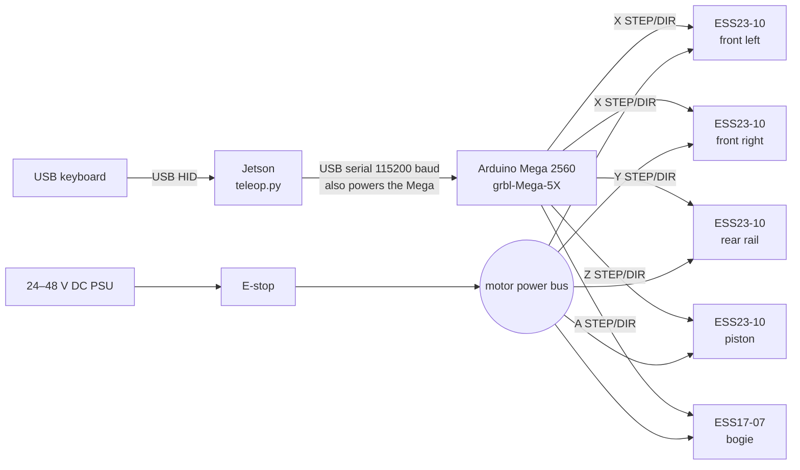
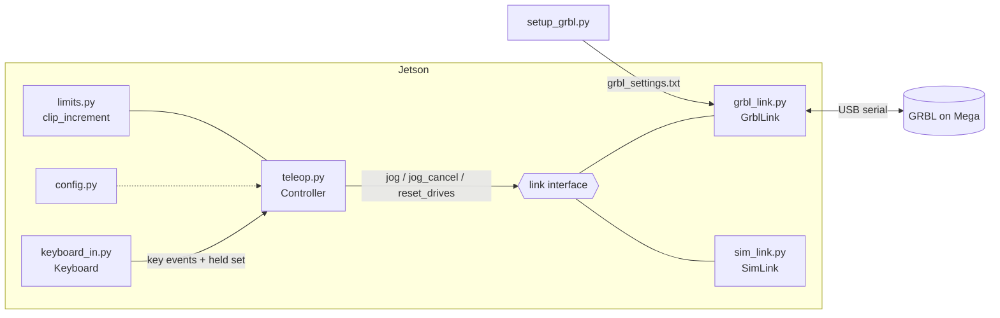
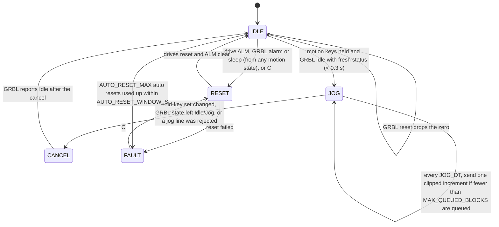

# arm-teleop

Keyboard teleoperation for the four linear axes of the arm (front rail pair, rear rail, piston, crossbar bogie).

A Jetson reads a USB keyboard and turns the held keys into short, limit-checked jog commands. It streams them over USB to an Arduino Mega 2560 running **grbl-Mega-5X**, which generates the acceleration profiles and STEP/DIR pulses for five closed-loop stepper drives.

The stack runs on its own. It has no inverse kinematics and no path planner: each key moves one axis, or a fixed combination of axes, at a chosen speed.

If a drive stalls or faults, its alarm output stops all motion through GRBL's abort input. The Jetson then resets the drives by itself, with no power cycle needed if MF clears the fault (see [Drive alarms and reset](#drive-alarms-and-reset)).

```
USB keyboard ──► Jetson: teleop.py ══ USB serial ══► Mega 2560: grbl-Mega-5X ── STEP/DIR 5 V ──► ESS drives ──► motors
                 keys → motion → limits → jog lines   accel planning + step pulses                closed loop
```

**Contents:**
[Quick start](#quick-start) ·
[Electrical architecture](#electrical-architecture) ·
[Software architecture](#software-architecture) ·
[Operating](#operating) ·
[Setup](#setup) ·
[Bring-up checklist](#bring-up-checklist) ·
[Known limitations](#known-limitations)

---

## Quick start

```bash
git clone https://github.com/Amitaansh/arm-teleop.git
cd arm-teleop
pip3 install -r requirements.txt

python3 teleop.py --sim      # no hardware: simulated motion, same keys and limits
python3 teleop.py            # real hardware (GRBL on /dev/ttyACM0)
```

You need Linux with access to `/dev/input` and the serial port (see [Setup](#setup)). On a new rig, follow the [bring-up checklist](#bring-up-checklist) before running against real motors.

---

## Electrical architecture

### System block diagram



Each drive also gets MF (motor free) from its axis's enable pin, and sends ALM (alarm) back. All five ALM lines are joined onto A9. See [Wiring](#wiring-per-drive).

There are two power domains, and their grounds are **not** joined:

| Domain | Source | Feeds | Ground |
|---|---|---|---|
| Logic | Jetson USB port (5 V) | Mega 2560, signal side of each drive's STEP/DIR/MF inputs and ALM output | Mega GND → PU− / DR− / MF− / ALM− on each drive |
| Motor power | 24–48 V DC supply, through the E-stop | VDC+ / GND on each drive | PSU return only |

The drives' STEP/DIR/MF inputs and ALM output are optically isolated, so the Mega only has to drive the input LEDs. Keep the PSU ground off Mega GND. That keeps motor return currents out of the USB and logic ground.

### Axes, drives and mechanics

| GRBL axis | Mechanism | Drive(s) | Transmission | Steps/mm (`$10x`) | Max rate (`$11x`) | Accel (`$12x`) | Travel from zero |
|---|---|---|---|---|---|---|---|
| X | Front rail pair | 2 × ESS23-10 (shared STEP/DIR) | Lead screw, 2 mm lead | 500 | 1200 mm/min (20 mm/s) | 100 mm/s² | 0 to 550 mm |
| Y | Rear rail | ESS23-10 | Lead screw, 2 mm lead | 500 | 1200 mm/min (20 mm/s) | 100 mm/s² | 0 to 550 mm |
| Z | Main piston | ESS23-10 | TBD | 100 *(placeholder)* | 2400 mm/min (40 mm/s) | 200 mm/s² | 0 to 500 mm *(placeholder)* |
| A | Crossbar bogie | ESS17-07 | 3:1 onto 15T AT5 belt pulley, 25 mm per motor rev | 40 | 6000 mm/min (100 mm/s) | 500 mm/s² | −224 to +224 mm |

All drives are set to 1000 pulses/rev, so steps/mm = 1000 ÷ (mm of travel per motor rev). The speeds start low on purpose. The rail screws can reach about 36 mm/s before whip, and the bogie belt about 250 mm/s. Raise the limits after bring-up.

### Wiring (per drive)

| ESS wire | Connects to |
|---|---|
| PU+ (red) | Mega STEP pin for that axis |
| DR+ (blue) | Mega DIR pin for that axis |
| PU− (yellow), DR− (black) | Mega GND |
| MF+ (brown) | Mega ENABLE pin for that axis |
| MF− (green) | Mega GND |
| ALM+ (white) | Joined with the other four ALM+ wires, then to A9 (GRBL reset/abort input) |
| ALM− (gray) | Mega GND |
| VDC+ / GND | 24–48 V supply after the E-stop. **Do not join this to Mega GND** |

Plus one part: a **4.7 kΩ pull-up from A9 to 5 V**.

**Front pair.** The two front drives move together as one GRBL axis. Both PU+ wires go on the X STEP pin, both DR+ wires on the X DIR pin, and both MF+ wires on the X ENABLE pin (D38). Each of those pins then drives about 20 mA, which is within AVR limits. If one front motor runs backwards, flip it with that drive's DIP SW1.

**MF (motor free).** Current through MF frees the motor. GRBL holds its enable pins LOW while running (`$4=0`), so the motors stay energised, and drives them HIGH only when it disables the steppers: on an alarm and in sleep (`$SLP`). `$1=255` keeps the motors energised while idle; any other value would free them every time motion stops.

**ALM (alarm).** Each ALM output is a transistor switch. They are wired in parallel, so any one faulted drive pulls A9 low. The code assumes the output switches **on** during a fault (`ALM_CONDUCTS_ON_FAULT = True` in `config.py`); check this during bring-up. A9 is GRBL's reset/abort input, so a fault stops all step pulses at once, in firmware, without waiting for the Jetson. Which drive faulted is not known: look for the blinking red LED.

**DIP switches (every drive).** SW2, SW3 and SW4 ON with SW5 OFF gives 1000 pulses/rev. This must match `$100`–`$103`. SW1 sets direction.

### Mega 2560 pin map

These pins come from grbl-Mega-5X's default RAMPS map. **Check `cpu_map.h` in your download before wiring.**

| Axis | STEP | DIR | ENABLE (→ MF+) |
|---|---|---|---|
| X (front pair) | A0 (D54) | A1 (D55) | D38 |
| Y (rear) | A6 (D60) | A7 (D61) | A2 (D56) |
| Z (piston) | D46 | D48 | A8 (D62) |
| A (bogie) | D26 | D28 | D24 |

| Input | Pin |
|---|---|
| Reset/abort (all five ALM+, 4.7 kΩ to 5 V) | A9 (D63) |

No limit, home or probe inputs are wired. GRBL soft and hard limits and homing are all off (`$20=$21=$22=0`). The Jetson enforces the travel limits instead (see [Software limits](#software-limits)).

### E-stop

The E-stop sits in the 24–48 V line, so pressing it removes motor power from all drives at once. It does not tell GRBL anything, so GRBL's position count is no longer trustworthy afterwards. **Re-zero after every E-stop.** Cycling the E-stop is also the manual way to clear a drive fault that the automatic reset could not clear (press C afterwards).

---

## Software architecture

### Modules



| File | Role |
|---|---|
| [`teleop.py`](teleop.py) | Entry point and `Controller`, which holds all teleop logic. The controller does no I/O of its own: it gets key events and the held-key set, and calls the link. `--sim` uses `SimLink`. `recover_drives()` holds the drive-reset retry policy |
| [`config.py`](config.py) | Single place for tunables: serial port, key map, axis letters, travel, pitch band, speeds and gears, jog streaming timing, drive alarm and reset settings |
| [`keyboard_in.py`](keyboard_in.py) | Linux evdev reader. Gives real key down/up events with several keys held at once, grabs the keyboard exclusively, and treats an unplug as releasing every key |
| [`limits.py`](limits.py) | Pure functions. Clips every jog increment against per-axis travel and the pitch band |
| [`grbl_link.py`](grbl_link.py) | **The only GRBL-specific file.** Handles the serial port, character-counting flow control, status polling and parsing (including the drive alarm from `Pn:R`), jog lines, realtime commands, and the drive reset sequence |
| [`sim_link.py`](sim_link.py) | Fake link with the same interface. Runs queued jogs at their feed rate, with no acceleration. Can simulate a drive stall (F12 in `--sim`) |
| [`rail_test.py`](rail_test.py) | Load test for the three vertical rails. Stops and resets the drives if a rail stalls |
| [`setup_grbl.py`](setup_grbl.py) + [`grbl_settings.txt`](grbl_settings.txt) | Writes the GRBL `$` settings, reads them back and verifies them. `--show` prints build info and the current settings |

### Threads

| Thread | Rate | Job |
|---|---|---|
| Main loop (`teleop.main`) | `LOOP_HZ` = 50 Hz | Takes keyboard events, calls `Controller.update()`, redraws the status line at `DISPLAY_HZ` = 5 Hz |
| Keyboard reader | Event driven | `select()` on the evdev device. Tracks the held set and reconnects after an unplug |
| GRBL reader | Event driven | Splits serial input into lines: `ok`/`error` acknowledge queued lines, `<...>` updates `Status`, a `Grbl ...` banner counts a reset, and `ALARM:N` is recorded |
| Status poller | `STATUS_HZ` = 20 Hz | Sends the realtime `?` byte |
| Drive reset worker | On demand | Runs `recover_drives()` (one to a few seconds) so the main loop keeps redrawing and reading keys meanwhile |

### Controller state machine



Each tick, `Controller.update()`:

1. Watches for problems. A GRBL reset (new banner) drops the zero and sets the stop latch. A drive alarm, GRBL alarm or GRBL sleep starts a drive reset (see [Drive alarms and reset](#drive-alarms-and-reset)). A rejected jog line triggers a cancel.
2. Handles **zeroing**. Once Z has been held for 1 s, it stores the current machine position (`MPos`) as zero, but only when both the controller and GRBL are idle.
3. Builds the **motion vector**. It adds up the direction vectors of every held motion key and caps each axis to [−1, +1], so W + ↑ does not drive the front pair at double speed. While the Space stop latch is set, the vector is zero until every motion key has been released.
4. Advances the state machine shown above.

### Jog streaming

- While motion keys are held, the Jetson sends `$J=G91 G21 X.. Y.. Z.. A.. F..` lines. Each covers `JOG_DT` (0.1 s) of motion at the current gear speed. When motion starts, `PREFILL` (2) lines go out back to back.
- At most `MAX_QUEUED_BLOCKS` (4) planner blocks sit inside GRBL at once, counted from the `Bf:` field of its status reports. If the Jetson side dies mid-jog, the arm coasts for at most about 4 × 0.1 s = 0.4 s.
- The feed `F` is the vector speed of the *clipped* move. Each axis therefore keeps its own gear speed, even when another axis is pinned at a limit.
- Any change in the held keys sends a jog cancel (realtime byte `0x85`). GRBL decelerates and flushes its buffer, and the next motion starts once it reports `Idle`. How quickly the arm stops after a release is set by GRBL's acceleration (`$12x`), not by how much is queued.
- Serial flow control uses GRBL's character-counting protocol. Bytes that GRBL has not yet acknowledged never exceed its 128-byte RX buffer.
- At startup the link sends `$10=3`, so status reports include `MPos` and buffer state.

### Software limits

GRBL cannot enforce soft limits without homing, so `limits.clip_increment()` does it on the Jetson. The check runs against `target`, the point where the already-queued motion will end, rather than the current position:

- **Per-axis travel** (`TRAVEL` in `config.py`). An axis that reaches a limit stops while the others keep moving.
- **Pitch band.** Barrel pitch is θ = asin((front − rear) / 600 mm), and it must stay within −35° to +40°. Because front − rear is linear in the two rail moves, only the front and rear parts of the increment are scaled back, landing exactly on the boundary.
- **Already outside a limit** (for example, after re-zeroing in a bad spot). Moving back inside is allowed and moving further out is blocked. The target never jumps.
- **Bogie travel** of ±224 mm keeps the yaw bearing angle asin(X_B / 600) at or below 22°.

The status line shows `LIMIT <axis>` while a limit is clipping motion.

### Zero handling

There are no home switches, so position is only known relative to a manual zero pose: **rails bottomed, piston retracted, bogie centred**. Until you set the zero:

- limits are **off**
- gear 1 (10%) is forced, whatever gear you selected

The zero is dropped automatically whenever the Mega resets, which includes every time the serial port is opened, and on any drive alarm, GRBL alarm or drive reset.

### Drive alarms and reset

The ESS drives close the loop internally with their own encoder. When the motor falls too far behind the commanded position (a stall: "position following error"), or on over-current or over-voltage, the drive frees the motor, blinks its red LED and switches on ALM. That is the only thing the encoder reports to the outside: the ESS has no encoder output, so the Jetson cannot read the true motor position.

What happens on a stall:

1. **Firmware stop.** ALM pulls A9 low. GRBL aborts at once (`ALARM:3` if it was moving), soft-resets, and reports `Pn:R` in every status report while ALM stays on.
2. **Jetson sees it** within one status poll (50 ms): `DRIVE ALM` on the status line. The controller drops the zero, sets the stop latch, and goes to `RESET`.
3. **Drive reset** (`GrblLink.reset_drives()`, in a worker thread):
   1. `$SLP` puts GRBL to sleep, which drives every enable pin HIGH, so MF frees **every** motor. This is held for `DRIVE_FREE_S[0]` (0.3 s), plus GRBL's own 0.255 s idle-lock delay.
   2. A soft reset (`0x18`) leaves sleep. GRBL keeps `MPos` and comes back in `Alarm`. `$X` unlocks it.
   3. GRBL only re-energises the motors when it starts a move, so a tiny jog on the bogie (`WAKE_MM` = 0.05 mm out, then back) releases MF on every drive.
   4. After `DRIVE_SETTLE_S`, it checks that ALM is off and GRBL is `Idle`.
4. If ALM is still on, it tries again with MF held for `DRIVE_FREE_S[1]` (1 s). Then, if `POWER_CYCLE_OFF_CMD` is set, it power-cycles the drives through the relay. If nothing works, the controller goes to `FAULT` and asks you to cycle the E-stop and press C.
5. On success the controller returns to `IDLE`. Motion stays off until every motion key is released, and the arm stays unzeroed (gear 1, limits off) until you re-zero.

Guards and settings (all in `config.py`):

- `AUTO_RESET = False` turns the automatic reset off; C still works.
- After `AUTO_RESET_MAX` (3) automatic resets inside `AUTO_RESET_WINDOW_S` (60 s), the next fault goes straight to `FAULT`. Repeated stalls mean something is jammed or overloaded, so a person should look first.
- A reset also clears a GRBL-only alarm (for example a noise spike on A9), and wakes GRBL if it was left asleep.
- `ALM_CONDUCTS_ON_FAULT = False` handles drives whose ALM switches *off* on a fault. GRBL can't abort in that case (A9 rises instead of falling), so the stop comes from the Jetson's jog cancel within a status poll.

**Why the zero is dropped.** The drive that stalled slipped by an unknown amount. The wired-together ALM lines don't say which drive it was. And every motor was free for a moment during the reset, so a vertical axis could have dropped a little.

**If MF does not clear the drive.** The ESS manual lists stall (Err5) and over-current (Err1) as "power down reset" faults. If the red LED stays on after the automatic reset, wire a relay module that cuts the drives' 24–48 V supply. Drive it from GRBL's coolant flood output (check `cpu_map.h` for the pin), so that `M8` cuts power and `M9` restores it, then set `POWER_CYCLE_OFF_CMD = "M8"`. GRBL turns coolant off on every reset, so the drives default to powered.

### Link interface (replacing GRBL)

`Controller` only uses the members below, which `GrblLink` and `SimLink` both provide. To move to custom firmware, rewrite `grbl_link.py` behind the same interface. Nothing else needs to change.

| Member | Meaning |
|---|---|
| `status` | `Status(state, mpos, planner_free, rx_free, t, pins, drive_alarm)`. `state` is `Idle`, `Jog`, `Alarm`, `Sleep`, …, `t` is the receive time, `pins` the raw `Pn:` letters, and `drive_alarm` is true while a drive's ALM says it is faulted |
| `planner_total` | Planner buffer size (largest `Bf` count seen) |
| `reset_count` | Increments on every firmware reset or banner |
| `error_count`, `last_error` | Count of rejected lines, and the most recent `(line, error)` |
| `last_alarm` | `(code, text)` of the most recent firmware alarm, or `None` |
| `failed` | `None`, or a message once the serial link has died |
| `jog(delta_mm, feed_mm_min)` | Queue a relative jog |
| `jog_cancel()` | Stop and flush the queued jog motion |
| `unlock()` | Clear a firmware alarm only |
| `reset_drives(free_s, wake_axis, wake_mm, settle_s)` | Free the motors (MF) for `free_s`, clear the firmware alarm, re-energise, check ALM. Returns `(ok, message)` |
| `power_cycle_drives(off_cmd, on_cmd, off_s, boot_s, …)` | Same, but cuts drive power through a relay instead of using MF |
| `close()` | Shut down the link |

---

## Operating

### Keys

| Key | Motion |
|---|---|
| ↑ / ↓ | Height: front and rear together |
| I / K | Pitch: front and rear in opposite directions (nose up / down) |
| W / S | Front pair only |
| E / D | Rear only |
| U / O | Piston in / out |
| J / L | Bogie left / right |
| 1 / 2 / 3 | Gear: 10% / 40% / 100% of `VMAX` |
| Space | Stop. Motion stays off until every motion key is released |
| Hold Z (1 s) | Set the current pose as zero. Only works while stopped |
| C | Reset the drives and clear any GRBL alarm (the same sequence as the automatic reset). Works in any state and resets the auto-reset count. Motors go limp for about half a second, and the zero is dropped |
| Esc | Quit. Ctrl-C does nothing on the grabbed keyboard; run with `--no-grab` to keep it |
| F12 | `--sim` only: simulate a drive stall |

Held keys add together, and each axis is capped at full speed. Edit the key map in `config.py` (`MOTION_KEYS`, `COMMAND_KEYS`).

### Command-line options

```
python3 teleop.py [--port /dev/ttyACM0] [--baud 115200] [--keyboard /dev/input/by-id/...-event-kbd] [--no-grab] [--sim]
python3 setup_grbl.py [--port ...] [--baud ...] [--file grbl_settings.txt] [--show]
```

### Status line

```
[JOG   ] gear 2 | Jog     | F  120.00 R   80.00 P    0.00 B    0.00 | pitch  +3.8deg | LIMIT pitch
```

From left to right: controller mode (`IDLE`, `JOG`, `CANCEL`, `RESET`, `FAULT`), active gear, GRBL state, position relative to zero (front, rear, piston, bogie), then the pitch angle once zeroed (or the `UNZEROED` warning), `DRIVE ALM` while a drive's alarm is on, `FAULT: press C` when a reset is needed, any limits that are active, and the stop latch.

---

## Setup

### Mega 2560 (once)

1. Download grbl-Mega-5X from [github.com/fra589/grbl-Mega-5X](https://github.com/fra589/grbl-Mega-5X).
2. In `grbl/config.h`, set the axis count to 4 and name axis 4 `A`.
3. Copy the `grbl` folder into your Arduino `libraries` folder.
4. Open *File → Examples → grbl → grblUpload*, select **Arduino Mega 2560**, and upload.
5. Check that the A axis is treated as **linear**. Some forks handle rotary axes differently when computing feed rate. If a bogie-only jog runs at the wrong speed, set axis 4 to linear, or rename it (e.g. `U`) and change `AXIS_LETTERS` in `config.py` to match.
6. Leave the defaults that the drive alarm handling relies on: in `cpu_map.h`, the RAMPS reset input on A9 (`CONTROL_RESET_BIT`) and the enable pins listed above; in `config.h`, `REPORT_FIELD_PIN_STATE` enabled (it puts `Pn:R` in status reports) and `INVERT_CONTROL_PIN_MASK` off.

### Jetson (once)

```bash
pip3 install -r requirements.txt          # pyserial, evdev
sudo usermod -aG input,dialout $USER      # keyboard + serial access; log out and back in
ls /dev/ttyACM*                           # Mega port (CH340 clones show up as ttyUSB*); set PORT in config.py if different
python3 setup_grbl.py                     # applies grbl_settings.txt to GRBL, reads back, verifies
```

---

## Bring-up checklist

1. **Key map with no motors.** Run `python3 teleop.py --sim`. Press every key and check the status line. Hold Z, then drive into each limit and confirm it stops at the right number. Press F12 while jogging: the status line should go `RESET`, then back to `IDLE` with the stop latch set.
2. **Settings.** `python3 setup_grbl.py` must end with `all settings verified.` If `$103` is missing, the firmware was built with fewer than 4 axes.
3. **Power on with the mechanism uncoupled** if possible, and start with the PSU current-limited.
4. **MF polarity.** Run `python3 teleop.py`. Every motor shaft must be stiff (energised). If they all turn freely, set `$4=1`. Press C: every shaft should go limp for about half a second, then stiffen again.
5. **ALM polarity.** With every drive powered and its LED green, the status line must **not** show `DRIVE ALM`. If it does, unplug the ALM+ wires one at a time to find the drive(s) responsible. If every drive does it, the outputs switch off on a fault: set `ALM_CONDUCTS_ON_FAULT = False` in `config.py`. A multimeter on A9 shows the same thing: about 5 V when healthy.
6. **Stall test,** one drive at a time, motor uncoupled or at gear 1: jog and hold the shaft (or block the carriage) until the red LED blinks. The status line should show `DRIVE ALM`, then `RESET`, then `IDLE` with the LED green, and the log should say `drives reset OK`. If you get `DRIVE RESET FAILED: ALM still active` and the LED stays red, MF does not clear a stall on these drives. Cycle the E-stop, press C, and fit the power-cycle relay described in [Drive alarms and reset](#drive-alarms-and-reset).
7. **Direction per axis.** Run `python3 teleop.py`. Gear 1 is forced because you haven't zeroed yet. Tap each key once and check the direction. Fix it with the drive's DIP SW1, or with `$3` in `grbl_settings.txt` as a fallback.
8. **Front pair.** W/S and ↑/↓ must move both front carriages identically. If they rack, stop and check the shared wiring.
9. **Calibrate steps/mm.** Zero at a marked spot, then jog until the reading is 20.00 mm. Measure the real travel and set `$10x = old × 20 / measured`. Do this for each axis. The piston's `$102` is a placeholder until then.
10. **Zero and limits.** Move to the true zero pose and hold Z. Drive slowly toward each travel end and toward the pitch limit (I/K), and check that each one clips.
11. **Speed.** Step through gears 2 and 3. Watch how far each axis travels between key release and stop. If you need more speed, raise `$11x` first, then `VMAX` (keep `VMAX` × 60 ≤ `$11x`).
12. **Fault tests:**
    - Esc mid-motion stops it.
    - Unplugging the keyboard mid-motion stops it.
    - Unplugging the Mega USB mid-motion coasts for no more than about 0.4 s of motion, then stops.
    - The E-stop cuts motor power.

---

## Known limitations

- **No position feedback.** The drives' encoders only close the loop inside each drive, and the ESS has no encoder output. GRBL only counts the pulses it sent. A stall is detected (ALM), but not by how much the axis slipped, so the zero has to be set again after one.
- **MF clearing a stall is unverified.** The ESS manual lists stall (Err5) as "power down reset". If MF doesn't clear it, auto reset needs the optional power-cycle relay.
- **A reset frees every motor** for about half a second, because GRBL drives all the enable pins together. A vertical axis whose screw can be back-driven may drop slightly.
- **The faulted drive isn't identified.** The ALM lines are joined on one pin; look for the red LED.
- **DIR setup time.** GRBL sets DIR and STEP in the same interrupt, but the drives want DIR set at least 5 µs earlier. In the worst case one 2 µm step is lost per reversal. If that ever matters, rebuild with `STEP_PULSE_DELAY` in `config.h`.
- **Bogie centring isn't enforced.** The pitch limits assume the bogie is near centre.
- **Piston numbers are placeholders.** `$102`, `$112` and the piston travel in `config.py` need updating once the actuator is finalised.
- **Linux only.** Keyboard input uses evdev.
